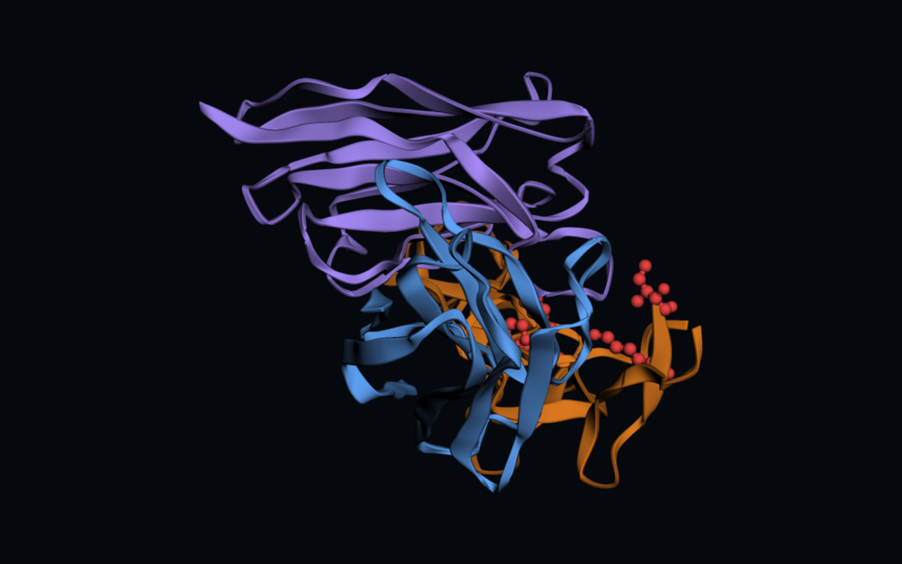

# team16-antibodies

This is Team 16's project from the [AI × Antibodies Hackathon](https://luma.com/16qoctcz) in Oslo, organised by [Nucleate Norway](https://www.linkedin.com/company/nucleate-norway) and held on 14 November 2026. The task set for the event was to design antibody binders against HER2, the receptor that the breast-cancer drug trastuzumab (Herceptin) targets, and to produce designs that look at least as good as trastuzumab itself on the measures available during the day.

Our approach was to teach an antibody-design model, [IgLM](https://github.com/Graylab/IgLM), what a strong HER2 binder looks like, and then let it improve on its own designs over several rounds. The rest of this README explains how that works and the reasoning behind each choice.



> One of our designed binders bound to HER2. The antibody's light chain is blue and its heavy chain, which carries the redesigned loop, is violet. HER2 is orange, and the four spots trastuzumab relies on to grip it are red. The structure was predicted by folding the binder and HER2 together in Boltz-2.

---

## Why we did not rank designs by structure confidence

Most antibody-design tools score a candidate by how confident a folding model is in the predicted shape of the complex, a number called ipTM. It is easy to compute, but it answers the wrong question. A confident-looking structure is not the same thing as a binder that actually holds on tightly.

We were able to check this directly, because the hackathon gave us real binding measurements. Comparing ipTM against measured binding strength (SPR affinity) across binders that spanned a 600,000-fold range, the two barely moved together: the rank correlation was only 0.285. Ranking designs by ipTM is therefore close to ranking them at random as far as affinity is concerned. So we used ipTM only as a rough geometry check and ranked on a signal that does track binding.

## How the method works

We fine-tuned IgLM on a HER2 binding screen of 524,346 variants so that it leans toward sequences that bind this particular target. We then ran it in a loop, and each pass through the loop nudged the model to do a little better:

1. The model proposes a large batch of new binding loops (the CDRH3 loop, the part of an antibody that does most of the gripping).
2. A fast scorer, trained on the same binding data, estimates how strong each loop is likely to be and drops anything that is not novel or not developable.
3. The best survivors are folded together with HER2 to confirm the predicted complex is sound.
4. The winners are added to the training data and the model is retrained before the next pass.

We ran this for six rounds:

```
         ┌──────────────────────────────────────────────┐
         │                                              ↻ │
   IgLM ──►  propose ~80k CDRH3  ──►  filter cascade  ──►  co-fold top 25  ──►  retrain on winners
 (HER2-      loops / cycle          novelty · binder      with HER2           (× 6 cycles)
  biased)                           classifier · dev      (Boltz-2 + OF3)
```

We ran two versions side by side from the same base model. In the optimisation track we kept trastuzumab's antibody intact and only rewrote its binding loop, so the rest of a known-good antibody stayed fixed. In the de-novo track we generated loops from scratch and required them to be less than 70% identical to trastuzumab's. Across the six rounds the model proposed 480,000 loops in total, and 144 of them were taken all the way to a folded complex with HER2.

<p align="center"></p>

> A single-domain VHH that the de-novo track generated from scratch.

## What happened over the six rounds

The whole point of the loop is that the designs should improve from one round to the next, and they did:

| Measure | Cycle 1 | Cycle 6 | |
|---|---|---|---|
| Usable designs (novel and developable) | 15% | 79% | 5× more |
| Mean predicted binder strength (0–1) | 0.29 | 0.48 | +0.19 |
| IgLM validation loss on strong binders | 3.11 | 1.34 | fell in 22 min |
| Epitope preserved | n/a | ~23 / 24 | held steady |
| Interface confidence, ipTM | n/a | ~0.93 | flat (trastuzumab 0.96) |

Two things we watched were whether the designs still aimed at the right part of HER2 and whether their structures stayed believable. Both held steady while novelty and predicted strength climbed, which is exactly what we hoped for: the model was finding genuinely new sequences without drifting off the target. By the sixth round, 16 of 24 candidates beat trastuzumab on at least two of the three properties we could compute, and two of them matched or beat it on all three (novelty, predicted strength and interface confidence). Those two head the shortlist we would hand to a wet lab.

## How to read a single candidate

For each design we report four checks:

| Check | What it asks | Keep if |
|---|---|---|
| Docks to HER2 | does the antibody latch on? (ipTM) | above 0.90 |
| Same patch | does it grip the same spot trastuzumab does? | 1.0 is a full match |
| Holds together | would it be stable enough to make? | clean developability flags |
| Buildable shape | do Boltz-2 and OpenFold3 agree on the fold? | both confident |

Every number here is a prediction. None of it is settled until the designs are built and tested at the bench. [`DECISIONS.md`](DECISIONS.md) records what we decided and why, and [`docs/report.md`](docs/report.md) has the run itself.

## Explore the designs

A self-contained 3D viewer of the shortlist (18 complexes) is in [`viz/`](viz/):

```bash
cd viz && python3 -m http.server   # then open dashboard.html
```

## Repo layout

| Path | What |
|---|---|
| `finetune_iglm.py` | HER2 fine-tuning of IgLM |
| `reward.py`, `affinity_surrogate.py` | the fast loop scorer (surrogate, rank correlation 0.72) |
| `novelty_filter.py`, `thermostability.py`, `epitope_check.py` | the filter cascade |
| `rank.py`, `shortlist.py` | gates to a ranked top-20, with a reason for each pick |
| `run_pipeline.sh`, `justfile` | end-to-end runbook |
| `viz/` | 3D dashboard and the co-folded `.cif` structures |
| `docs/` | pitch, build spec, VM runbook, figures |
| [`SCORERS.md`](SCORERS.md) | every scorer: what it scores, how fast it is, how to call it |

## Run it

```bash
just test              # every gate's self-check
just pipeline all      # end-to-end (see docs/VM-RUN.md)
just rank-all metrics  # Boltz-2 metrics → ranked top-20
```

Dependencies resolve from `requirements.txt` through `uv`. Weights and seeds are pinned, and every number traces back to a run id.

## Caveats

- The fast scorer only looks at the 10-residue loop, so it cannot judge changes anywhere else in the antibody, and it becomes unreliable for sequences far from its training data.
- Apo-pLDDT is a proxy for how confidently the structure folds, not a measured melting temperature.
- The binder score predicts a rough affinity class, not a precise SPR number.
- Every result here is computational. The experiments are what would come next.

## Team 16

| Name | LinkedIn | GitHub |
|---|---|---|
| Lachlan Marie | [lachlan-marie](https://www.linkedin.com/in/lachlan-marie/) | [lacamar](https://github.com/lacamar) |
| Nazmul Hoque | | |
| Alisher Ubaydolla | | [Alihimik](https://github.com/Alihimik) |
| Laurenz Wicke | [laurenz-wicke](https://www.linkedin.com/in/laurenz-wicke-b9744b366/) | [Ltwicke](https://github.com/Ltwicke) |
| Nguyen Ngoc Lan | [lan-ngoc-nguyen](https://www.linkedin.com/in/lan-ngoc-nguyen/) | [lanngoc10a](https://github.com/lanngoc10a) |

## Acknowledgements

The whole thing was built in a day at BI Norwegian Business School, at a hackathon organised by Nucleate Norway for around 80 people. The compute and the models came from the event partners:

- Nebius: an NVIDIA H100 cloud machine for each team.
- Apheris: the Foundry models and the HER2 design weights, run on that machine.
- JapanFold: high-throughput structure prediction (Boltz-2, OpenFold3 and others).
- Amass: research-intelligence credits.

Claude accounts from Anthropic were provided for the teams to build with.
