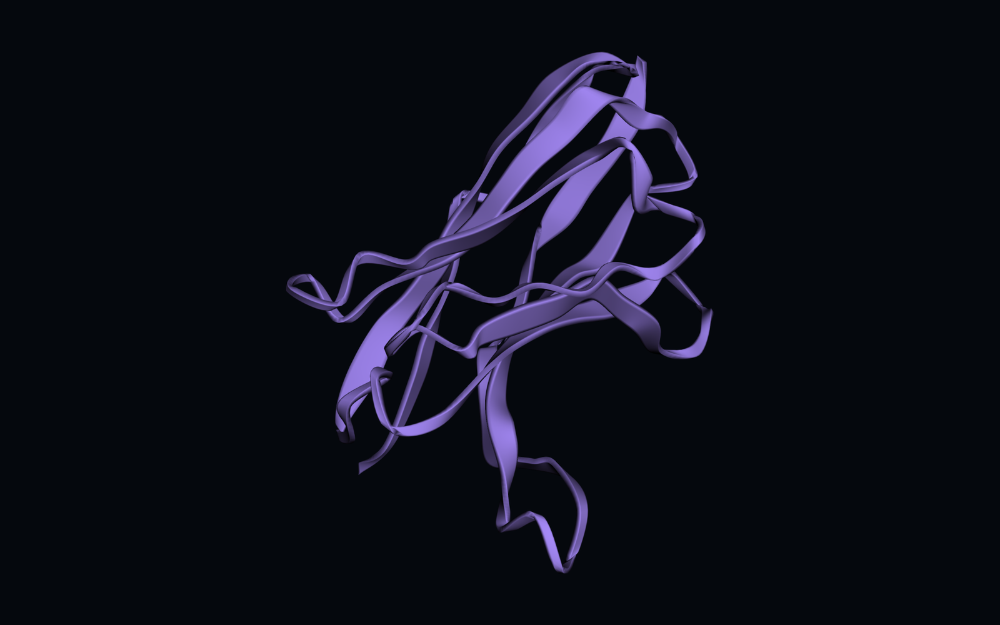

# team16-antibodies

**AI × Antibodies Hackathon, Oslo, 14 Nov 2026. Team 16.**

Antibody binders against **HER2** that beat trastuzumab in silico. We fine-tune an antibody language model on a HER2 screen and run it in a loop, each cycle retraining on its own best designs.


> A designed binder (VL blue · VH with the redesigned CDRH3 violet) bound to HER2 domain IV (orange) at trastuzumab's epitope hotspots C572/C573/D591/D593 (red), co-folded with Boltz-2.

---

## The idea

Most antibody tools rank designs by **fold confidence** (ipTM), but that doesn't measure how tightly a binder actually sticks. On this target, ipTM tracks measured SPR affinity at **Spearman 0.285** across a 600,000-fold K_D range, so we do not rank on it.

We **fine-tune [IgLM](https://github.com/Graylab/IgLM) on a 524,346-variant HER2 FACS screen**, then run it in a loop for six cycles. The model proposes loops, a surrogate scores them, the best are co-folded against HER2, and the winners retrain the model. We keep fold confidence only as a geometry gate.

## The loop

```
         ┌──────────────────────────────────────────────┐
         │                                              ↻ │
   IgLM ──►  propose ~80k CDRH3  ──►  filter cascade  ──►  co-fold top 25  ──►  retrain on winners
 (HER2-      loops / cycle          novelty · binder      with HER2           (× 6 cycles)
  biased)                           classifier · dev      (Boltz-2 + OF3)
```

**Two tracks from one base model:**
- **Optimisation:** rewrite trastuzumab's CDRH3 grip loop, everything else fixed.
- **De-novo:** generate loops from scratch, under 70% identity to trastuzumab.

**480,000 loops proposed, 144 complexes co-folded.**

<p align="center"></p>

> A de-novo single-domain VHH the loop generated from scratch.

## Results

| Signal | Cycle 1 | Cycle 6 | |
|---|---|---|---|
| **Usable designs** (novel + developable) | 15% | **79%** | ▲ 5× |
| **Mean predicted binder strength** (0–1) | 0.29 | **0.48** | ▲ +0.19 |
| **IgLM validation loss** (strong binders) | 3.11 | **1.34** | fell in 22 min |
| **Epitope preserved** | n/a | **~23 / 24** | held steady |
| **Interface confidence** (ipTM) | n/a | **~0.93** | flat (trastuzumab 0.96) |

By cycle 6, **16 of 24** candidates beat trastuzumab on at least 2 of 3 computed properties. **Two leads match or beat it on all three** (novelty, predicted strength, interface confidence) and head the wet-lab shortlist.

## Reading a candidate: four checks

| Check | What it asks | Keep if |
|---|---|---|
| **Docks to HER2** | does the antibody latch on? (ipTM) | > 0.90 |
| **Same patch** | contact overlap with trastuzumab's epitope | = 1.0 is a full match |
| **Holds together** | developability / stability heuristic | clean flags |
| **Real, buildable shape** | Boltz-2 **and** OpenFold3 agree on the fold | both high |

Every number here is a **prediction**, and none of it is settled until the designs are built and tested at the bench. See [`DECISIONS.md`](DECISIONS.md) for the decision/rejected/why/evidence trail and [`docs/report.md`](docs/report.md) for the run.

## Explore the designs

A self-contained 3D viewer of the shortlist (18 complexes) is in [`viz/`](viz/):

```bash
cd viz && python3 -m http.server   # then open dashboard.html
```

## Repo layout

| Path | What |
|---|---|
| `finetune_iglm.py` | HER2 fine-tuning of IgLM |
| `reward.py`, `affinity_surrogate.py` | fast loop reward (surrogate, Spearman 0.72) |
| `novelty_filter.py`, `thermostability.py`, `epitope_check.py` | the filter cascade |
| `rank.py`, `shortlist.py` | gates → ranked top-20 with a reason per pick |
| `run_pipeline.sh`, `justfile` | end-to-end runbook |
| `viz/` | 3D dashboard + co-folded `.cif` structures |
| `docs/` | pitch, build spec, VM runbook, figures |
| [`SCORERS.md`](SCORERS.md) | every scorer: what it scores, speed, how to call it |

## Run it

```bash
just test              # every gate's self-check
just pipeline all      # end-to-end (see docs/VM-RUN.md)
just rank-all metrics  # Boltz-2 metrics → ranked top-20
```

Deps resolve from `requirements.txt` via `uv`. Weights and seeds are pinned, and every number traces to a run id.

## Caveats

- The surrogate is a one-hot model on the 10-mer CDRH3. It cannot score changes outside the loop, and extrapolates poorly far from the training data.
- Apo-pLDDT is a fold-confidence proxy, **not** a measured melting temperature.
- The binder score predicts a lab affinity *class*, not an SPR number.
- Final verdicts are experimental.

## Team 16

Lachlan Marie · Nazmul Hoque · Alisher Ubaydolla · Laurenz · Nguyen Ngoc Lan
